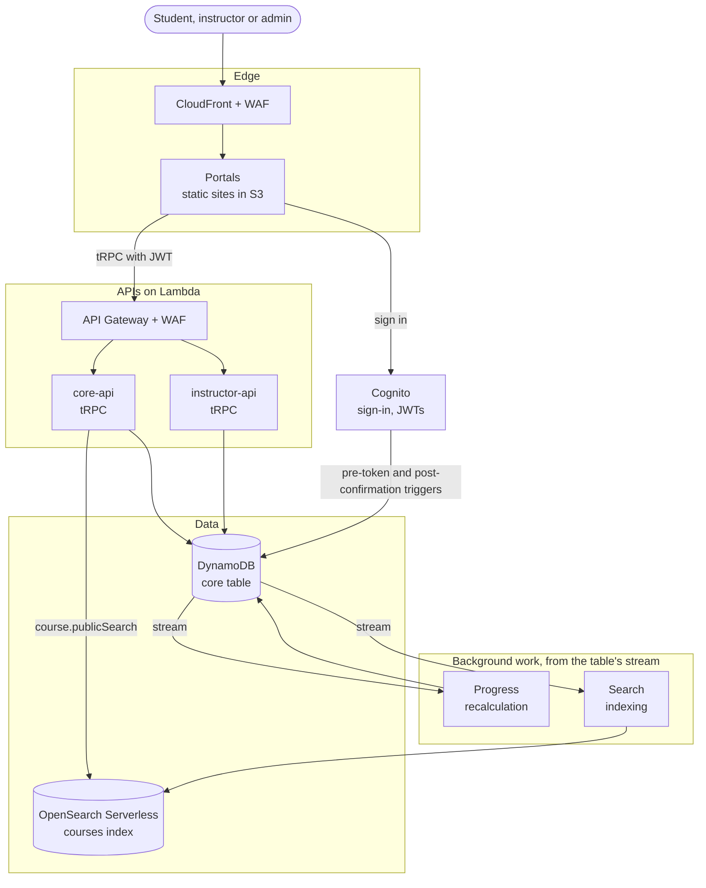
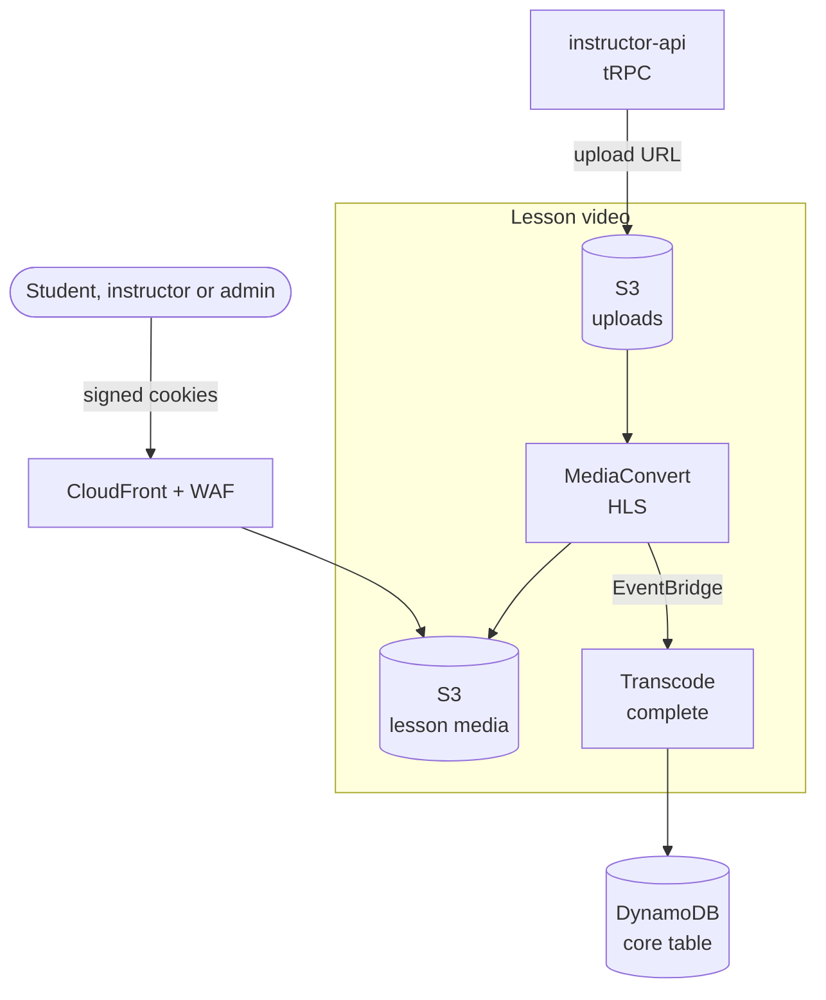

  <h1>Discava</h1>
  <h3>The serverless, AI-native Learning Management System</h3>
  
  
  
  

---

> [!IMPORTANT]
> Discava is under active development and is not yet feature complete. Expect breaking changes and rough edges until a stable release is tagged.

**Discava** is a free and open source, serverless, AWS-native Learning Management System: course delivery, enrolment, and student/instructor/admin portals, deployable to your own AWS account.

It's opinionated by design: one cloud provider, one way to deploy, rather than a pluggable backend you configure yourself. The trade-off is deliberate, easier to deploy and fewer integration quirks, instead of maximum backend flexibility. And it's built with agentic AI from the start rather than bolted on later: an AI assistant and personalised learning are part of the core experience, not a paid add-on.

## Architecture

Request flow: a portal through Cognito and the APIs to the data layer, plus the background work kept in sync from the DynamoDB stream.

Lesson video: upload, transcode and delivery.

Both leave out the dead-letter queues, KMS encryption, AppConfig runtime config, scheduled cleanup of old video output, and the CDK deployment path. See the [docs site](https://alexto.github.io/discava/) for more detail.

## Tech stack

- [Nx](https://nx.dev) monorepo ([pnpm](https://pnpm.io) workspaces), built with [`@aws/nx-plugin`](https://awslabs.github.io/nx-plugin-for-aws)
- Serverless AWS: [Lambda](https://aws.amazon.com/lambda/), [DynamoDB](https://aws.amazon.com/dynamodb/) ([ElectroDB](https://electrodb.dev)), [Cognito](https://aws.amazon.com/cognito/), [CDK](https://aws.amazon.com/cdk/) infra
- Edge and storage: [Amazon S3](https://aws.amazon.com/s3/) for lesson media, uploads, course images and the portals' static assets, served through [Amazon CloudFront](https://aws.amazon.com/cloudfront/) with signed cookies and URLs for private lesson video, and [AWS WAF](https://aws.amazon.com/waf/) protecting the APIs and CloudFront distributions
- Lesson video: [AWS Elemental MediaConvert](https://aws.amazon.com/mediaconvert/) transcodes uploaded video to HLS
- APIs: [Amazon API Gateway](https://aws.amazon.com/api-gateway/) fronting the tRPC APIs
- Events: [Amazon EventBridge](https://aws.amazon.com/eventbridge/) and [EventBridge Scheduler](https://aws.amazon.com/eventbridge/scheduler/) for transcode events and delayed cleanups, [Amazon SQS](https://aws.amazon.com/sqs/) dead-letter queues for the stream consumers
- Config and security: [AWS AppConfig](https://aws.amazon.com/systems-manager/features/appconfig/) for runtime configuration the Lambdas and portals read, [AWS KMS](https://aws.amazon.com/kms/) for customer-managed encryption, relaxed per stage in development
- Search: [Amazon OpenSearch Serverless](https://aws.amazon.com/opensearch-service/features/serverless/) on NextGen collections, which scale all the way to zero when idle (no cost between searches), kept in sync from the DynamoDB stream
- [React](https://react.dev) + [Vite](https://vite.dev) frontends with [TanStack Router](https://tanstack.com/router), [Tailwind](https://tailwindcss.com), and [shadcn/ui](https://ui.shadcn.com)
- [tRPC](https://trpc.io) API
- Agentic AI (planned): [Amazon Bedrock](https://aws.amazon.com/bedrock/), [Bedrock AgentCore](https://aws.amazon.com/bedrock/agentcore/), and [Strands Agents](https://strandsagents.com) for an in-app assistant and personalised learning paths

## Documentation

Full documentation, including architecture and guides, lives at the [Discava docs site](https://alexto.github.io/discava/).

## License

Apache License 2.0, see [LICENSE](LICENSE).

## Contributing

Contributions are welcome, see [CONTRIBUTING.md](CONTRIBUTING.md).
